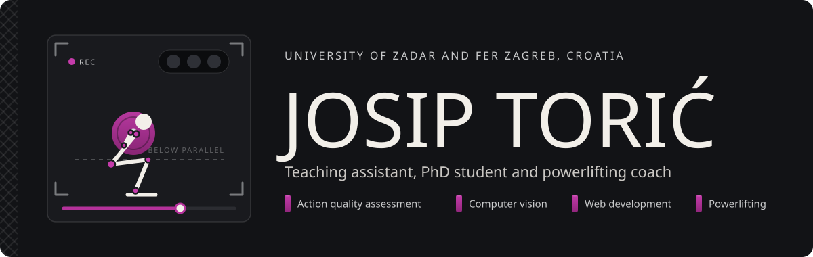

Teaching assistant in the undergraduate professional study programme in Information Technology (SIT) at the University of Zadar, and PhD student at the Faculty of Electrical Engineering and Computing (FER), University of Zagreb.

## Now

- Teaching assistant in Information Technology (SIT) at the **[University of Zadar](https://sit.unizd.hr/profesor/6abee2e0a889a8b5ed45a1b1)**
- PhD student at **[FER, University of Zagreb](https://www.fer.unizg.hr/)**, working on action quality assessment
- Vice President and National Team Selector of the **[Croatian Powerlifting Federation](https://www.hpls-powerlifting.hr/o-nama)**
- President of **[PLK Nabildani Mozak](https://plknabildanimozak.hr/)**
- Online powerlifting coach at **[toric.coaching](https://coaching.toric-usluge.hr/)**

## Research

My research is on action quality assessment: automatically judging how well a movement is performed from video, with powerlifting as the main use case.

- **A Pilot Study of Action Quality Assessment with Vision-Language Models on Powerlifting Video Data** J. Torić, M. Šarlija and L. Petrović, MIPRO Robotics 2026 [doi:10.1109/MIPROROBOTICS70521.2026.11761899](https://doi.org/10.1109/MIPROROBOTICS70521.2026.11761899)

All publications are on [Google Scholar](https://scholar.google.com/citations?user=-V1Pv1AAAAAJ&hl=en).

## Teaching

Projects built during lectures and lab sessions. The course materials and repository READMEs are in Croatian.

| Course | Repository | Stack |
| --- | --- | --- |
| Web Programming (2026/27) | [situnizd-pzw-projekt](https://github.com/jtoric/situnizd-pzw-projekt) | FastAPI, SQLAlchemy, Vue 3, TypeScript |
| Web Programming (2025/26) | [pzw-unizd-oglasnik](https://github.com/jtoric/pzw-unizd-oglasnik) | Flask, MongoDB |
| Web Application Development | [rwa-powerlifting-prijave](https://github.com/jtoric/rwa-powerlifting-prijave) | FastAPI, PostgreSQL, Vue 3 |
| Introduction to Web Technologies | [uwt-training-programs](https://github.com/jtoric/uwt-training-programs) | HTML, CSS, JavaScript |
| STEM Games preparation | [STEM-t-arena](https://github.com/jtoric/STEM-t-arena) | algorithms, Python |

## Web projects

The code for these is private, but the sites are live. Most of them run on FastAPI, MongoDB and Vue 3; toric.coaching uses FastAPI, PostgreSQL and Next.js.

- **[sit.unizd.hr](https://sit.unizd.hr/)**: website of the Information Technology study programme at the University of Zadar.
- **[hpls-powerlifting.hr](https://www.hpls-powerlifting.hr/)**: website of the Croatian Powerlifting Federation, with news, competitions, national records, qualifying standards and club rankings.
- **[plknabildanimozak.hr](https://plknabildanimozak.hr/)**: website of the powerlifting club Nabildani Mozak from Biograd na Moru, with news, lifters' results and national records.
- **[coaching.toric-usluge.hr](https://coaching.toric-usluge.hr/)**: my online powerlifting coaching (toric.coaching), with individual programming, video feedback on every session and competition preparation.
- **[sailhouse.toric-usluge.hr](https://sailhouse.toric-usluge.hr/)**: website of Sailhouse Apartments in Biograd na Moru, in four languages, with an availability calendar and direct booking synced with Rentlio.
- **[kb-coaching.hr](https://kb-coaching.hr/)**: website of KB coaching, a fitness coaching business in Rijeka, with services, a price list and a sign-up form.
- **[plkbehemot.hr](https://plkbehemot.hr/)**: website of the powerlifting club Behemot from Zadar, with news, lifters' results and national records.
- **[ispit.hpls-powerlifting.hr](https://ispit.hpls-powerlifting.hr/)**: online written exam for national referees of the Croatian Powerlifting Federation.
- **[svjetla.hpls-powerlifting.hr](https://svjetla.hpls-powerlifting.hr/)**: referee lights for competitions of the Croatian Powerlifting Federation. The three referees and the jury vote from their phones, and the decision is shown on a TV. Access is PIN-protected.

## Student work (FER)

- [Master's thesis, 2020](https://github.com/jtoric/Master-Thesis-FER-2020)
- [Bachelor's thesis, 2018](https://github.com/jtoric/Bachelor-Thesis-FER-2018)
